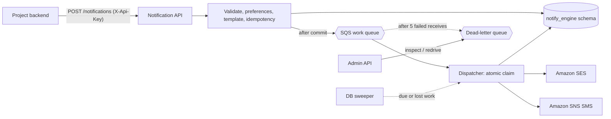

# notification-engine-v2

A generic, multi-project notification service. Any project submits a notification through one HTTP contract;
the engine validates it, applies the user's preferences, renders a versioned template, stores it, and delivers it
through email (Amazon SES), SMS (Amazon SNS), in-app inbox, or (later) mobile push. It is independent of the ERP
and does not import any ERP code. The older `backend/notification-engine` is kept untouched as a reference.

**For teams integrating a project: start at [`docs/integration/README.md`](docs/integration/README.md)** (flow, outbox pattern, error handling, OpenAPI spec and a runnable Postman collection).

- Stack: Java 21, Spring Boot 3.5.3, Maven, JPA + Flyway, PostgreSQL (H2 in tests), AWS SDK v2, springdoc.
- Port `8082`, context path `/api/v1`, Swagger UI at `/api/v1/swagger-ui.html`.
- Database schema `notify_engine` (created by Flyway in the same database the ERP uses; no second database).

## Architecture



```mermaid
sequenceDiagram
  participant App as Project backend
  participant API as Engine API
  participant DB as PostgreSQL
  participant Q as SQS
  participant W as Dispatcher
  participant AWS as SES / SNS
  App->>API: POST /notifications (idempotencyKey)
  API->>DB: insert PENDING row per channel (+ events)
  API-->>App: 202 {notifications:[{id,status:PENDING}]}
  API->>Q: {"notificationId": "..."} (after commit)
  Q->>W: deliver message
  W->>DB: UPDATE ... PENDING -> PROCESSING (atomic claim; losers stop)
  W->>AWS: send rendered content
  alt accepted
    W->>DB: SENT + attempt + event
  else transient (throttle / 5xx / timeout)
    W->>DB: PENDING, next_attempt_at = backoff + jitter
  else permanent (invalid recipient, rejected, template missing)
    W->>DB: FAILED (retryable=false)
  end
  W->>Q: delete message
```

**Design decisions**
- The database is the source of truth; SQS is an accelerator. A scheduled sweeper re-enqueues due or lost work, so a
  failed enqueue or a crashed worker never loses a notification. With `NOTIFY_QUEUE_ENABLED=false` the engine delivers
  in-process (an executor after commit) and the sweeper handles retries, so AWS SQS is optional.
- Duplicate queue deliveries and concurrent workers are safe: only the worker that wins
  `UPDATE ... SET status='PROCESSING' WHERE status='PENDING'` sends.
- `SENT` means the provider accepted the message, not that the recipient received it. `DELIVERED` is used for in-app items.
  Provider delivery receipts (SES event publishing, SNS delivery status logging) are not wired up.
- SQS messages contain only `{"notificationId": "..."}`; no recipient data or content passes through the queue.
- Multi-project isolation is implemented because this engine is meant to be shared. Every query is scoped by `project_id`
  taken from the API key, never from the request body. (The ERP itself is single-organisation and does not need this.)
- Failure handling: transient errors retry with bounded exponential backoff plus jitter up to `max-attempts`, then
  `FAILED` (retryable, manually retryable). Permanent errors fail immediately. Unexpected worker errors leave the SQS
  message in place so it is redelivered and eventually dead-lettered.

## Integrating another project

1. A platform admin creates the project and issues a key (the key value is shown once and stored only as a SHA-256 hash):
   ```bash
   curl -XPOST $BASE/admin/projects -H "X-Api-Key: $ADMIN" -H 'Content-Type: application/json' \
     -d '{"code":"a1-crusher","name":"A1 Crusher ERP","defaultSenderEmail":"no-reply@your-verified-domain"}'
   curl -XPOST $BASE/admin/projects/a1-crusher/keys -H "X-Api-Key: $ADMIN" -H 'Content-Type: application/json' \
     -d '{"label":"erp-backend","scopes":["SEND","READ","RETRY","TEMPLATES","PREFERENCES","OTP","INBOX"]}'
   ```
   Scopes: `SEND`, `READ`, `RETRY`, `TEMPLATES`, `PREFERENCES`, `OTP`, `INBOX`. Use the narrowest set per integration.
2. The project defines its own templates (per code, channel, locale; each change creates a new version):
   ```bash
   curl -XPOST $BASE/templates -H "X-Api-Key: $KEY" -H 'Content-Type: application/json' -d '{
     "code":"approval-requested","channel":"EMAIL","subject":"Approval needed for #{{id}}",
     "bodyHtml":"<p>Hi {{name}}, #{{id}} needs approval.</p>","bodyText":"Hi {{name}}, #{{id}} needs approval."}'
   ```
   `{{variable}}` placeholders are required; HTML bodies escape values. SMS templates take `bodyText` and may carry a
   `dltTemplateId`.
3. The project sends notifications. It depends only on this HTTP contract, never on AWS classes:
   ```bash
   curl -XPOST $BASE/notifications -H "X-Api-Key: $KEY" -H 'Content-Type: application/json' -H 'X-Correlation-Id: req-123' -d '{
     "type":"APPROVAL_REQUESTED","category":"APPROVAL","channels":["EMAIL","IN_APP"],
     "templateCode":"approval-requested","locale":"en",
     "recipient":{"ref":"user-42","email":"ops@example.com","phone":"+919876543210"},
     "variables":{"name":"Ops","id":101},"priority":"HIGH","idempotencyKey":"weighment-101-approval",
     "scheduledAt":null,"expiresAt":"2026-12-31T00:00:00Z"}'
   # 202 {"requestId":"...","notifications":[{"id":"...","channel":"EMAIL","status":"PENDING",...},{"channel":"IN_APP","status":"DELIVERED",...}]}
   ```
   Send a stable `idempotencyKey` for every business event; replays return the original notifications without resending
   (a concurrent duplicate may get `409 DUPLICATE_REQUEST`: just retry). Omit `channels` to use the configured defaults
   for the category (`notify.default-channels.*`).

## API summary

All routes are under `/api/v1` and need `X-Api-Key`. Errors look like `{"code","message","correlationId"}`; internals,
provider payloads and stack traces are never returned. `X-Correlation-Id` is accepted or generated and returned.

| Route | Scope | Purpose |
|---|---|---|
| `POST /notifications` | SEND | Create and dispatch (202) |
| `GET /notifications/{id}` | READ | Status (never includes recipient contact data or variables) |
| `GET /notifications?status&channel&type&category&recipientRef&from&to&page&size` | READ | History, paginated (max 100) |
| `POST /notifications/{id}/retry` | RETRY | Retry a FAILED notification whose failure is retryable |
| `GET/PUT /notification-preferences` | PREFERENCES | Per user, channel and category consent |
| `POST /otp/send`, `POST /otp/verify` | OTP | One-time codes (see below) |
| `POST/GET /templates`, `PATCH /templates/{id}/active` | TEMPLATES | Versioned templates |
| `GET /inbox`, `PATCH /inbox/{id}/read` | INBOX | In-app items for one user (`recipientRef`) |
| `POST/DELETE /devices` | INBOX | Register push device tokens |
| `POST/GET /admin/projects`, `POST/DELETE /admin/projects/{code}/keys`, `PATCH /admin/projects/{code}/status` | platform admin | Onboarding |
| `GET /admin/dlq`, `POST /admin/dlq/redrive` | platform admin | Dead-letter inspection and recovery |

**Preferences and consent.** `OTP`, `VERIFICATION` and `SYSTEM` are mandatory and cannot be turned off. `MARKETING` is
opt-in: it is cancelled (status `CANCELLED`, code `PREFERENCE_OPT_OUT`, kept for audit) unless the user has an enabled
preference. Other categories are on unless the user turned them off.

**OTP.** `POST /otp/send {channel: EMAIL|SMS, recipient, purpose}` returns `{challengeId, expiresInSeconds, resendAfterSeconds}`
and never the code. Controls: only a salted HMAC of the code is stored; 5-minute expiry; 3 to 5 verify attempts (configurable,
counted atomically); resend cooldown (429 with `Retry-After`); hourly send cap per recipient; single use; delivery is
synchronous and a failed delivery returns 502 and leaves no usable challenge. The code is never logged or persisted; the audit
row has no variables or contact data. Define a project template with code `otp` and variables `code`, `ttlMinutes`, `purpose`
(needed for India DLT-approved text) or the built-in default is used. OTPs cannot be sent through `POST /notifications`.

## Statuses

`PENDING` (accepted, waiting), `PROCESSING` (claimed by a worker), `SENT` (provider accepted), `DELIVERED` (in-app stored),
`FAILED`, `CANCELLED` (suppressed by preference). Every transition is written to `notification_events`; every provider call to
`notification_attempts`.

## Configuration

Everything is externalised (see `.env.example` and `src/main/resources/application.properties`). Notable settings:

| Setting | Meaning |
|---|---|
| `NOTIFY_PROVIDER_MODE` | `log` (default: never calls AWS, logs metadata only) or `aws` (SES + SNS) |
| `NOTIFY_QUEUE_ENABLED`, `NOTIFY_QUEUE_URL`, `NOTIFY_DLQ_URL` | SQS work queue and DLQ; off means in-process delivery |
| `NOTIFY_BOOTSTRAP_ADMIN_KEY` | Platform admin key; blank disables `/admin` |
| `NOTIFY_OTP_PEPPER` | Secret for OTP hashes (must be set in production) |
| `notify.retry.*` | max attempts, base and max delay, jitter |
| `notify.rate-limit.*`, project `rateLimitPerMin` / `dailyQuota` | Per-project token bucket and rolling 24h quota (429) |
| `notify.retention.days` / `contact-days` | Row deletion and early wipe of recipient contact data and variables |
| `notify.channels.*`, `NOTIFY_PUSH_ENABLED` | Channel feature flags |
| `notify.default-channels.<CATEGORY>` | Channels used when a request omits them |

In production put secrets in AWS Secrets Manager or SSM Parameter Store and inject them as environment variables (for example
through ECS task definition `secrets`). Use an IAM role for AWS access; do not set `AWS_ACCESS_KEY_ID` in production.

## AWS setup

**IAM policy for the service role**
```json
{
  "Version": "2012-10-17",
  "Statement": [
    {"Effect": "Allow", "Action": ["ses:SendEmail"], "Resource": "arn:aws:ses:ap-south-1:ACCOUNT:identity/your-domain.example"},
    {"Effect": "Allow", "Action": ["sns:Publish"], "Resource": "*"},
    {"Effect": "Allow", "Action": ["sqs:SendMessage","sqs:ReceiveMessage","sqs:DeleteMessage","sqs:GetQueueAttributes","sqs:ChangeMessageVisibility"],
     "Resource": ["arn:aws:sqs:ap-south-1:ACCOUNT:notify-prod","arn:aws:sqs:ap-south-1:ACCOUNT:notify-prod-dlq"]}
  ]
}
```
(`sns:Publish` to a phone number cannot be scoped to a resource ARN.)

**SES**: verify the sending domain or address in the region (DKIM + SPF), set `defaultSenderEmail` per project to a verified
identity, optionally create a configuration set for delivery events. New accounts start in the **sandbox**: you can only send to
verified recipients and at low limits. Request production access in the SES console before real traffic. Throttling and
`LimitExceeded` errors are treated as transient; `MessageRejected` and unverified identities are permanent.

**SQS**: create a standard queue with visibility timeout above the longest send (default 60 s), long polling (10 s), and a
redrive policy to a DLQ with `maxReceiveCount` 5 (`infra/localstack/init-notify-v2.sh` is a working example). Set a CloudWatch
alarm on DLQ depth. Recovery: `GET /admin/dlq` to inspect, fix the cause, `POST /admin/dlq/redrive` to move messages back.

**SMS in India**: SNS does not deliver Indian SMS without DLT registration. Before production you need: a registered entity on a
DLT portal (Jio, Airtel, Vi, BSNL), an approved sender ID (header) and approved content templates, SNS moved out of the SMS
sandbox, and an SMS spend limit set. Store the entity id on the project (`smsEntityId`), the sender id (`smsSenderId`) and the
template id on each SMS template (`dltTemplateId`); the engine passes them as `AWS.MM.SMS.EntityId`, `AWS.MM.SMS.TemplateId`
and `AWS.SNS.SMS.SenderID`. Template text must match the approved DLT template exactly. Nothing here assumes registration is done.

**Push**: the provider interface and device-token table exist. FCM/APNs are not implemented; to enable push set
`NOTIFY_PUSH_ENABLED=true` and `NOTIFY_PUSH_CHANNEL_ENABLED=true` and register a `PushProvider` bean.

## Running

```bash
# unit + integration tests (no AWS needed; providers are mocked, H2 in memory)
mvn test

# local stack with Postgres + LocalStack queues (opt-in profile; existing services are untouched)
export NOTIFY_BOOTSTRAP_ADMIN_KEY=$(openssl rand -hex 16)
docker compose --profile notify-v2 up -d --build notification-engine-v2
curl localhost:8082/api/v1/actuator/health
```
If LocalStack was already running, create the queues once with
`docker exec -i crusher-erp-localstack sh < infra/localstack/init-notify-v2.sh`.
Local mode sends nothing real (`NOTIFY_PROVIDER_MODE=log`); switching to `aws` needs real SES/SNS access.

## Operations

- Health: `/api/v1/actuator/health` (liveness and readiness groups). Logs are structured key=value lines carrying
  `correlationId` (MDC) and never contain recipient addresses, message content or OTPs.
- Stuck work: rows left in `PROCESSING` longer than `processing-timeout-seconds` are returned to `PENDING` (or failed when
  attempts ran out) by the sweeper.
- Retention: contact data and variables are wiped after 7 days, rows deleted after 90 days (configurable).
- Cost: SES is billed per email, SNS per SMS (India SMS costs far more than email; DLT adds provider fees), SQS per request
  (long polling keeps this low). Delete the queues, SES identities and SNS spend settings when decommissioning.

## Known limits

- Provider delivery receipts (bounces, complaints, SMS delivery status) are not consumed; `SENT` is the final state for email/SMS.
- Rate limiting buckets are per instance (in memory); the daily quota is enforced from the database and is shared.
- Preferences and inbox are keyed by a `ref` supplied by the calling project, which is trusted because it holds the API key.
- Real SES/SNS calls are unit tested with mocked clients only; verify with a real sandbox account before launch.
