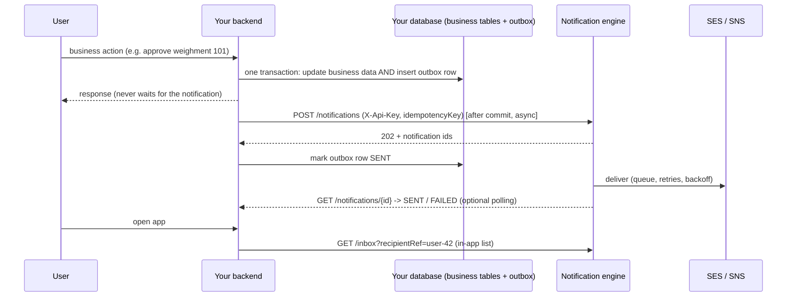

# Integrating with the Notification Engine

For backend teams (any language) that want to send email, SMS, in-app and OTP messages through the shared notification engine.
You only need an HTTP client. You never touch AWS, and you never touch the engine's database.

| File | Use |
|---|---|
| [`openapi.yaml`](openapi.yaml) | The API contract (OpenAPI 3.1). Import into Postman/Insomnia, or generate a client. |
| [`postman/notification-engine.postman_collection.json`](postman/notification-engine.postman_collection.json) | The full flow as runnable requests with assertions (54 requests). |
| [`postman/local.postman_environment.json`](postman/local.postman_environment.json), [`aws.postman_environment.json`](postman/aws.postman_environment.json) | Environments (placeholders, no secrets). |
| [`examples/setup-project.sh`](examples/setup-project.sh) + [`examples/crusher-erp.seed.json`](examples/crusher-erp.seed.json) | One command that creates a project, loads 17 ready-made templates and issues the project key. Sample data for a crusher-plant ERP. |
| `GET {baseUrl}/api/v1/swagger-ui.html` | Live Swagger UI on a running engine. |

## 1. How it fits together



**Who owns what**

| | Owner | Rule |
|---|---|---|
| Your business tables and your **outbox** | Your backend | Only your code writes here |
| `notify_engine.*` (notifications, attempts, events, templates, preferences) | The engine | Never read or write these from your project |

The engine is generic: it contains no project-specific logic. Your wording lives in **templates**, your events are just `type` strings.

## 2. Onboarding a project (platform admin, once)

1. Create the project (the admin key is held by the engine owner, never by projects):
   ```bash
   curl -XPOST $BASE/api/v1/admin/projects -H "X-Api-Key: $ADMIN" -H 'Content-Type: application/json' \
     -d '{"code":"sharique-erp","name":"Sharique ERP","defaultSenderEmail":"no-reply@your-verified-domain"}'
   ```
   Optional: `rateLimitPerMin`, `dailyQuota`, `sesConfigSet`, `smsSenderId` and `smsEntityId` (India DLT).
2. Issue a key per service and environment with the narrowest scopes. The key appears **once**; the engine keeps only a hash.
   ```bash
   curl -XPOST $BASE/api/v1/admin/projects/sharique-erp/keys -H "X-Api-Key: $ADMIN" -H 'Content-Type: application/json' \
     -d '{"label":"erp-backend-prod","scopes":["SEND","READ"]}'
   ```
   | Scope | Allows |
   |---|---|
   | `SEND` | `POST /notifications` |
   | `READ` | `GET /notifications`, `GET /notifications/{id}` |
   | `RETRY` | `POST /notifications/{id}/retry` |
   | `TEMPLATES` | create/list/activate templates |
   | `PREFERENCES` | read/update user preferences |
   | `OTP` | `/otp/send`, `/otp/verify` |
   | `INBOX` | in-app inbox and device tokens |
3. Hand the key to the project team through a secret channel (never chat, email or git). They store it as `NOTIFY_API_KEY`.
4. Rotate by issuing a new key, deploying it, then `DELETE /admin/projects/{code}/keys/{id}`. Revocation is immediate.
5. Use separate projects (or separate engine deployments) for development and production.

**Isolation.** The project is taken from the API key, never from the request body. Notifications, templates, preferences, OTP challenges and idempotency keys are separate per project. Reading another project's notification returns `404`. Rate limit and daily quota are per project.

### How do I get the project key?

| Question | Answer |
|---|---|
| Who can create a project key? | Only the platform admin (the engine owner), with the **admin key**. Projects cannot create their own. |
| Where does the key come from? | From the response of `POST /admin/projects/{code}/keys` (the setup script prints it). It looks like `ntf_...` and is shown **once**. |
| Where do I find it later? | Nowhere: the engine stores only a hash, so it cannot be recovered or shown again. Keep it in a secret manager (`NOTIFY_API_KEY`). |
| I lost it. | Issue a new key (`POST .../keys`), deploy it, then revoke the old one (`DELETE .../keys/{id}`). |
| Which keys exist for my project? | `GET /admin/projects/{code}/keys` (admin) returns id, prefix, label, scopes, active, created and last used. Never the raw key. The prefix (`ntf_AsC3`) lets you match a key to the one in your config. |
| Where does the admin key come from? | The engine owner sets it when deploying (`NOTIFY_BOOTSTRAP_ADMIN_KEY`, for example `openssl rand -hex 16`). Treat it like a root password: it creates projects and keys but cannot send notifications. |

## 3. Templates (once per message type)

Wording is defined in the engine, so the backend only sends data.
```bash
curl -XPOST $BASE/api/v1/templates -H "X-Api-Key: $KEY" -H 'Content-Type: application/json' -d '{
  "code":"approval-requested","channel":"EMAIL","locale":"en",
  "subject":"Approval needed for weighment #{{id}}",
  "bodyHtml":"<p>Hi {{name}}, weighment <b>#{{id}}</b> needs approval.</p>",
  "bodyText":"Hi {{name}}, weighment #{{id}} needs approval."}'
```
- One template per `code` + `channel` (+ `locale`). Posting the same code again creates a new **version**; new notifications use the latest active one, and each notification pins the version it was accepted with.
- Every `{{placeholder}}` must be supplied in `variables`, otherwise the request fails with `400 TEMPLATE_VARIABLE_MISSING`. HTML bodies escape values.
- `SMS`, `PUSH` and `IN_APP` templates use `bodyText`. For India SMS add the approved `dltTemplateId`; the text must match the DLT template exactly.

## 4. Sending a notification

```http
POST {baseUrl}/api/v1/notifications
X-Api-Key: <your project key>
X-Correlation-Id: <your request id, optional>
Content-Type: application/json

{
  "type": "WEIGHMENT_APPROVAL_REQUESTED",
  "category": "APPROVAL",
  "channels": ["IN_APP", "EMAIL"],
  "templateCode": "approval-requested",
  "recipient": { "ref": "user-42", "email": "ops@example.com", "phone": "+919876543210" },
  "variables": { "name": "Ops", "id": 101 },
  "priority": "HIGH",
  "idempotencyKey": "weighment-101-approval-requested"
}
```
Response `202 Accepted`:
```json
{ "requestId": "fee7363e-...", "notifications": [
  { "id": "86bf0590-...", "channel": "EMAIL",  "status": "PENDING",   "attempts": 0, ... },
  { "id": "bd3aca6b-...", "channel": "IN_APP", "status": "DELIVERED", "title": "Approval required", ... } ] }
```

| Field | Notes |
|---|---|
| `type` | Your event name; free-form; used for filtering and reports |
| `category` | `APPROVAL`, `SUCCESS`, `ERROR`, `WARNING`, `INFO`, `REMINDER`, `SYSTEM`, `MARKETING`. `OTP` is rejected here (use `/otp/send`). `OTP`, `VERIFICATION`, `SYSTEM` ignore user opt-outs; `MARKETING` needs explicit consent. |
| `channels` | `IN_APP`, `EMAIL`, `SMS`, `PUSH`. Omit to use the engine's default for the category. One notification is created per channel. |
| `recipient.ref` | Your own user id. Required for in-app and push; used by preferences and the inbox. |
| `recipient.email` / `phone` | Required for `EMAIL` / `SMS`. Phone must be E.164 (`+91` mobiles: 10 digits starting 6-9). |
| `variables` | Template values. **No secrets**: they are stored until the contact-data retention wipe (7 days by default). |
| `idempotencyKey` | **Use one stable key per business event** (`<entity>-<id>-<event>`). A replay returns the original notifications and never sends twice. |
| `scheduledAt` / `expiresAt` | Optional ISO-8601 times |

**Statuses.** `PENDING` (accepted), `PROCESSING` (a worker has it), `SENT` (the provider accepted it, **not** proof the user received it), `DELIVERED` (in-app item stored), `FAILED`, `CANCELLED` (suppressed by the user's preferences). The API never returns recipient contact data or variables.

**Checking the result** (optional): `GET /notifications/{id}`, or `GET /notifications?status=FAILED&from=...` for a report. In-app items for your UI: `GET /inbox?recipientRef=user-42` and `PATCH /inbox/{id}/read?recipientRef=user-42`.

## 5. The outbox pattern (recommended for every project)

If your backend calls the engine directly and crashes between "commit" and "call", the notification is lost. Record the intent in your own database in the **same transaction** as the business change, then send it from there.

```sql
create table notification_outbox (
  id               bigserial primary key,
  idempotency_key  varchar(200) not null unique,   -- same value you send to the engine
  payload          jsonb        not null,          -- the exact POST /notifications body
  status           varchar(16)  not null default 'PENDING',   -- PENDING | SENT | FAILED
  attempts         int          not null default 0,
  next_attempt_at  timestamptz  not null default now(),
  engine_id        uuid,
  last_error       varchar(200),
  created_at       timestamptz  not null default now()
);
create index on notification_outbox (status, next_attempt_at);
```

1. In the business transaction: update your data **and** insert the outbox row. Commit.
2. After the commit (and again from a scheduled job every few seconds), select `PENDING` rows with `next_attempt_at <= now()` (use `FOR UPDATE SKIP LOCKED` so two instances do not send the same row) and `POST` each payload with `X-Api-Key`, a 2 second timeout and the row's `idempotencyKey`.
3. React to the response:

| Response | Do this |
|---|---|
| `202` | Mark `SENT`, store `engine_id` |
| Timeout, `5xx`, `429` | Keep `PENDING`; set `next_attempt_at` with exponential backoff and jitter (honour `Retry-After`); retry with the **same** key |
| `409 DUPLICATE_REQUEST` | Retry; you will get the original notification back |
| `400`, `404`, other `409` | Mark `FAILED`; the payload is wrong. Log it and alert a developer. Do not retry unchanged. |
| `401`, `403` | Stop and alert: the key is wrong, revoked, or lacks the scope |

4. Alert on rows stuck `PENDING` too long and on any `FAILED` row. Delete `SENT` rows after a retention period.

Rules: never call the engine **before** the business transaction commits; never block the user's request on the call; never put secrets in `variables`.

## 6. Errors

Every error has the same body. Branch on `code`, show `message` to humans, and log `correlationId` (it matches the engine's logs; send your own `X-Correlation-Id` to link the two systems).
```json
{ "code": "TEMPLATE_NOT_FOUND", "message": "No active template 'welcome' for channel EMAIL", "correlationId": "7f5d415f-..." }
```

| HTTP | Codes | Retry? | Action |
|---|---|---|---|
| 400 | `VALIDATION_ERROR`, `BAD_REQUEST`, `INVALID_EMAIL`, `INVALID_PHONE`, `TEMPLATE_NOT_FOUND`, `TEMPLATE_VARIABLE_MISSING`, `USE_OTP_API`, `NO_CHANNELS`, `CHANNEL_DISABLED`, `RECIPIENT_REQUIRED`, `ALREADY_EXPIRED`, `VARIABLES_TOO_LARGE`, `MANDATORY_CATEGORY`, `INVALID_TEMPLATE`, `INVALID_SCOPE` | No | Fix the request or setup |
| 400 | `OTP_INVALID`, `OTP_EXPIRED` | No | Tell the user; let them request a new code |
| 401 | `UNAUTHENTICATED` | No | Fix or rotate the key; alert |
| 403 | `FORBIDDEN`, `PROJECT_REQUIRED` | No | The key lacks the scope |
| 404 | `NOT_FOUND` | No | Wrong id, or it belongs to another project |
| 409 | `DUPLICATE_REQUEST` | Yes | Retry with the same key |
| 409 | `NOT_RETRYABLE`, `RECIPIENT_PURGED`, `PROJECT_EXISTS`, `QUEUE_DISABLED`, `DLQ_NOT_CONFIGURED` | No | See the message |
| 429 | `RATE_LIMITED`, `QUOTA_EXCEEDED` | Yes, after `Retry-After` | Slow down; ask the platform owner to raise limits |
| 429 | `OTP_RESEND_COOLDOWN`, `OTP_SEND_LIMIT`, `OTP_ATTEMPTS_EXCEEDED` | After `Retry-After` | Tell the user to wait |
| 502 | `OTP_DELIVERY_FAILED` | User may resend | The code could not be delivered; no usable challenge exists |
| 500 | `INTERNAL_ERROR` | Yes, with backoff | Report with the `correlationId` if persistent |

## 7. OTP

`POST /otp/send {"channel":"EMAIL","recipient":"ops@example.com","purpose":"login"}` returns `{challengeId, expiresInSeconds, resendAfterSeconds}`. The code is **never** returned; it is delivered to the recipient. Then `POST /otp/verify {"challengeId":"...","code":"123456"}`.
Controls: salted hash only, 5 minute expiry, limited attempts, resend cooldown and hourly cap per recipient, single use. Define a project template with code `otp` and variables `code`, `ttlMinutes`, `purpose` for approved wording (needed for India DLT), otherwise a plain default is used.

## 8. Try it

**Postman:** Import the collection and an environment, set `adminKey` (secret) and `baseUrl`, then run the collection top to bottom. Folder 1 creates a fresh project and key and stores them in variables, so every run is isolated. For real delivery use the AWS environment: set `recipientEmail` to an SES-verified address and `waitMs` to about 4000.

**Command line (no Postman needed):**
```bash
docker run --rm --network host -v "$PWD/postman":/etc/newman postman/newman run notification-engine.postman_collection.json \
  -e local.postman_environment.json --env-var baseUrl=http://localhost:8082 --env-var adminKey=$ADMIN
```

**Generate a client from the spec**, for example Java or TypeScript: `openapi-generator-cli generate -i openapi.yaml -g typescript-fetch -o client`. Point the client at the second server, `{scheme}://{host}/api/v1` (set `scheme` and `host`), or simply configure your client's base URL as `https://<engine-host>/api/v1`, and send the `X-Api-Key` header on every request. (The first server, `/api/v1`, is relative and is meant for Swagger UI.)

**Regenerate the spec** after changing the API: `./export-openapi.sh http://localhost:8082`.

## 9. Worked example: A1 Crusher ERP

Everything below is runnable. It is a complete sample for a crusher-plant ERP: one project, one backend key, seven message types.

### One command setup
```bash
cd examples
ENGINE_URL=http://localhost:8082 ADMIN_KEY=<platform admin key> ./setup-project.sh          # project + templates + key
ENGINE_URL=http://localhost:8082 ADMIN_KEY=<platform admin key> ./setup-project.sh --demo   # plus three sample notifications
```
What it does, in order: (1) creates the project from `crusher-erp.seed.json`; (2) issues a temporary key with only the `TEMPLATES` scope and revokes it when finished; (3) loads the 17 templates, skipping any that already exist; (4) issues the project key `erp-backend` with scopes `SEND, READ, PREFERENCES, INBOX, OTP` and prints it **once** (`NOTIFY_API_KEY=ntf_...`). Re-running is safe: the project and templates are skipped, and an existing active key is kept unless you set `FORCE_NEW_KEY=1`. Needs bash, curl and python3. Edit the seed file for your own sender address, rate limits and wording; for India SMS set `smsSenderId`, `smsEntityId` and each SMS template's `dltTemplateId`.

### The templates

| Template `code` | Channels | Variables | Send it when |
|---|---|---|---|
| `weighment-approval-requested` | EMAIL, IN_APP, SMS | `weighmentId`, `vehicleNo`, `material`, `requestedBy` | A load differs from the first ticket and needs approval |
| `weighment-approval-decision` | EMAIL, IN_APP | `weighmentId`, `decision`, `decidedBy` | The approval was approved or rejected |
| `invoice-generated` | EMAIL, IN_APP | `invoiceNo`, `customerName`, `amount`, `dueDate` | An invoice is created |
| `credit-limit-warning` | EMAIL, IN_APP, SMS | `customerName`, `usedPercent`, `creditLimit` | A customer passes a credit threshold |
| `tds-due-reminder` | EMAIL, IN_APP | `month`, `amount`, `dueDate` | A scheduled reminder before the TDS due date |
| `weighbridge-offline` | EMAIL, IN_APP, SMS | `site`, `minutes` | No weighbridge data for N minutes |
| `otp` | EMAIL, SMS | `code`, `ttlMinutes`, `purpose` | Used automatically by `/otp/send` |

Every `{{variable}}` of a template must be sent for each channel you request, or the call fails with `400 TEMPLATE_VARIABLE_MISSING`.

### Sample requests (as your backend would send them)
All use `POST /api/v1/notifications` with `X-Api-Key: $NOTIFY_API_KEY`.

**Approval requested** (to the approver, in-app and email):
```json
{ "type": "WEIGHMENT_APPROVAL_REQUESTED", "category": "APPROVAL", "channels": ["IN_APP", "EMAIL"],
  "templateCode": "weighment-approval-requested", "priority": "HIGH",
  "recipient": { "ref": "user-42", "email": "approver@a1group.example" },
  "variables": { "weighmentId": 101, "vehicleNo": "MH12AB1234", "material": "20mm aggregate", "requestedBy": "Loader operator" },
  "idempotencyKey": "weighment-101-approval-requested" }
```
**Approval decision** (back to the requester):
```json
{ "type": "WEIGHMENT_APPROVAL_DECISION", "category": "SUCCESS", "channels": ["IN_APP"],
  "templateCode": "weighment-approval-decision",
  "recipient": { "ref": "user-17" },
  "variables": { "weighmentId": 101, "decision": "approved", "decidedBy": "Plant manager" },
  "idempotencyKey": "weighment-101-approval-approved" }
```
**Invoice generated**:
```json
{ "type": "INVOICE_GENERATED", "category": "INFO", "channels": ["IN_APP", "EMAIL"],
  "templateCode": "invoice-generated",
  "recipient": { "ref": "user-42", "email": "accounts@a1group.example" },
  "variables": { "invoiceNo": "INV-2026-0055", "customerName": "Shree Constructions", "amount": "INR 1,24,500", "dueDate": "2026-11-10" },
  "idempotencyKey": "invoice-55-generated" }
```
**Credit limit warning** (SMS to the account owner, India mobile in E.164):
```json
{ "type": "CREDIT_LIMIT_WARNING", "category": "WARNING", "channels": ["IN_APP", "SMS"],
  "templateCode": "credit-limit-warning",
  "recipient": { "ref": "user-42", "phone": "+919876543210" },
  "variables": { "customerName": "Shree Constructions", "usedPercent": 92, "creditLimit": "INR 5,00,000" },
  "idempotencyKey": "customer-310-credit-92-2026-10" }
```
**Weighbridge offline** (operational alert, `SYSTEM` ignores opt-outs):
```json
{ "type": "WEIGHBRIDGE_OFFLINE", "category": "SYSTEM", "channels": ["IN_APP", "EMAIL", "SMS"],
  "templateCode": "weighbridge-offline", "priority": "URGENT",
  "recipient": { "ref": "user-5", "email": "ops@a1group.example", "phone": "+919812345678" },
  "variables": { "site": "Plant 1", "minutes": 10 },
  "idempotencyKey": "weighbridge-plant1-offline-2026-10-11T10" }
```
**TDS reminder**:
```json
{ "type": "TDS_DUE", "category": "REMINDER", "channels": ["IN_APP", "EMAIL"],
  "templateCode": "tds-due-reminder",
  "recipient": { "ref": "user-9", "email": "accounts@a1group.example" },
  "variables": { "month": "October 2026", "amount": "INR 48,200", "dueDate": "2026-11-07" },
  "idempotencyKey": "tds-2026-10-reminder" }
```
**Login OTP** (a different route; the code is generated and delivered by the engine and never returned):
```http
POST /api/v1/otp/send   {"channel":"SMS","recipient":"+919876543210","purpose":"login"}
POST /api/v1/otp/verify {"challengeId":"<from send>","code":"<what the user received>"}
```

### Your own templates
Template changes need a key with the `TEMPLATES` scope. The `erp-backend` key deliberately does not have it, so the running application cannot change wording; the setup script uses a temporary `TEMPLATES` key that it revokes afterwards, or the admin can issue a longer-lived one for whoever manages templates.

Copy an entry in `crusher-erp.seed.json`, change `code`, subject and body, use `{{placeholders}}` for the dynamic parts, and rerun the script (existing templates are skipped, so only new ones are created). To change wording of an existing template, `POST /templates` again with the same `code` and `channel`: that creates version 2, used by new notifications. To retire one, `PATCH /templates/{id}/active?value=false`.

## 10. Go-live checklist

- [ ] Project created; production key issued with only the scopes needed; key stored in a secret manager
- [ ] Templates created for every channel you use (and DLT ids for India SMS)
- [ ] Outbox table and sender job in place, with backoff, alerts on stuck and failed rows
- [ ] A stable idempotency key per business event
- [ ] Calls happen after commit, asynchronously, with a 2 second timeout
- [ ] No secrets in `variables`; OTPs only through `/otp`
- [ ] Error handling follows section 6; `correlationId` is logged
- [ ] Engine owner has: SES production access and a verified sender domain, a DLQ alarm, and has raised your rate limit and quota if needed
- [ ] Collection run passes against the production-like environment
